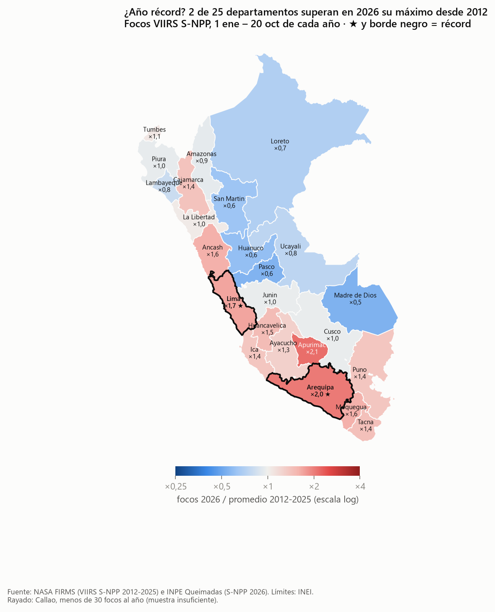
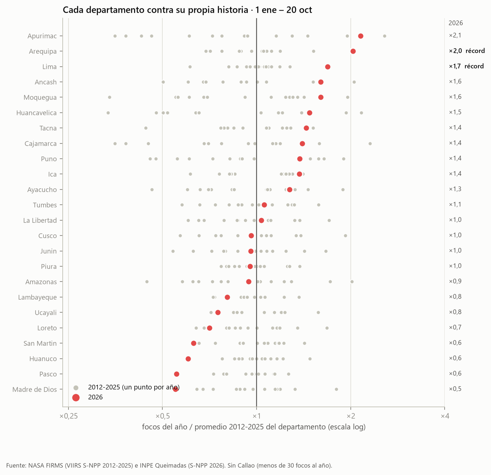
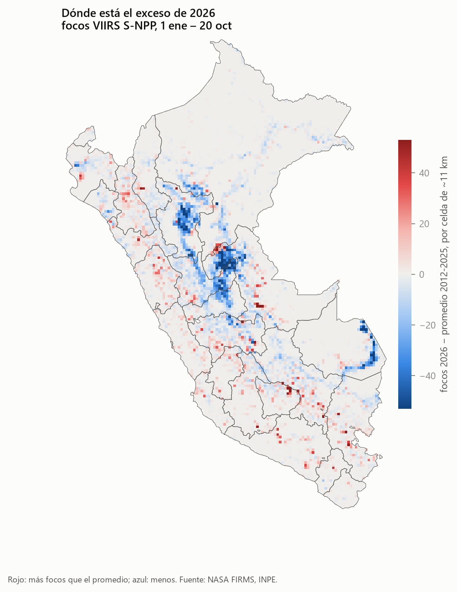
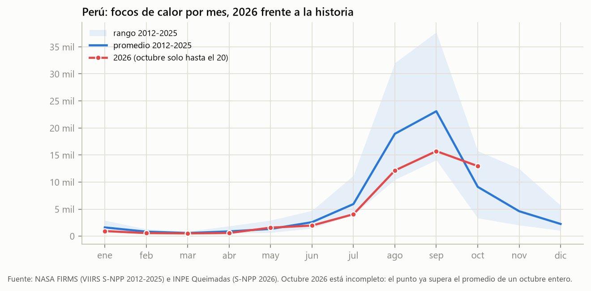
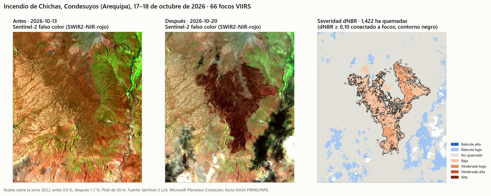

# ¿Es 2026 un año récord de incendios en el Perú?

**Pregunta E · 2026 frente a 2012–2025, por departamento.**
Curso de Capacitación en Python Intermedio para CCSS y Gestión Pública · Clase 5, «Incendios en el Perú, vistos desde el espacio» · 21 de octubre de 2026.

> **Respuesta corta.** Para el país en conjunto, **no**: del 1 de enero al 20 de octubre el Perú suma 50 996 focos de calor, 0,81 veces su promedio 2012–2025 (puesto 12 de 15). **Pero sí donde y cuando importa**: Arequipa y Lima baten su récord en las cuatro medidas probadas, y los primeros 20 días de octubre de 2026 son los más intensos de toda la serie, tanto a nivel nacional como en 9 departamentos andinos.

**Tablero interactivo:** [`docs/index.html`](docs/index.html) (ábralo en el navegador o publíquelo con GitHub Pages; ver [Cómo reproducir](#cómo-reproducir)).



---

## Tres hallazgos con números

| # | Hallazgo | Cifra clave |
|---|---|---|
| 1 | **2026 no es récord nacional.** Entre el 1 de enero y el 20 de octubre hubo 50 996 focos VIIRS S-NPP, frente a un promedio de 62 607 en la misma ventana de 2012–2025. Es el puesto 12 de 15, lejos del máximo de 2024 (86 964). Pesa el déficit amazónico: Huánuco, Pasco y Madre de Dios tienen su cifra más baja desde 2012 (×0,60, ×0,55 y ×0,55 su promedio). | **×0,81** el promedio |
| 2 | **Arequipa y Lima: récord robusto.** Arequipa registra 962 focos frente a su máximo previo de 718 (2013): +34 %, el doble de su promedio y 4,8 desviaciones estándar sobre la media. Lima: 715 frente a 542 (2016), +32 %, z = 4,2. Ambos son récord con las tres ventanas de tiempo y también con la energía radiativa del fuego (FRP: ×2,6 y ×2,1). | **+34 %** sobre el récord previo (Arequipa) |
| 3 | **Octubre de 2026 es el más intenso de la serie.** Del 1 al 20 de octubre hubo 12 953 focos, 1,89 veces el promedio y por encima de 2020 (12 712). Nueve departamentos con muestra suficiente marcan récord de octubre: Áncash (×8,2), Apurímac (×7,0), Arequipa (×5,4), Huancavelica (×4,9), Ayacucho (×4,5), Lima (×4,3), Moquegua (×2,8), Cusco (×2,6) y Junín (×2,4). Tacna también, pero con muy pocos focos. | **12 953** focos en 20 días |

Y una cifra de superficie: el incendio más grande de Arequipa en el periodo con imágenes limpias, en **Chichas (Condesuyos)**, quemó **≈ 1 422 ha** según el dNBR (rango de 199 a 2 013 ha según el método; ver [Caso dNBR](#caso-dnbr-el-incendio-de-chichas-arequipa)).

<table>
<tr>
<td width="50%"></td>
<td width="50%"></td>
</tr>
</table>



La curva mensual explica la aparente contradicción entre los hallazgos 1 y 3: 2026 corrió **por debajo** de lo normal hasta septiembre y se disparó en octubre. El récord de 2026 es **tardío y andino**, no amazónico.

---

## Datos y sus fechas

Todo es público, sin clave ni pago (las fuentes que recomienda la lámina «Datos que ustedes pueden usar»).

| Dato | Fuente | Tipo | Cobertura usada |
|---|---|---|---|
| Focos de calor 2012–2025 | NASA FIRMS, archivo anual por país `viirs-snpp_<año>_Peru.csv` | Puntos (CSV) | 1 ene 2012 – 31 dic 2025 (procesamiento estándar, versión 2) |
| Focos de calor 2026 | INPE Programa Queimadas, CSV mensual de Sudamérica (`focos_mensal_2026MM.csv`), satélites `NPP-375` y `NPP-375D` | Puntos (CSV) | 1 ene – 20 oct 2026 (archivo de octubre actualizado el 21/10/2026) |
| Calibración | FIRMS NRT `SUOMI_VIIRS_C2_South_America_7d.csv` e INPE `focos_mensal_202509.csv` | Puntos (CSV) | 15–19 oct 2026 y septiembre 2025 |
| Límites | INEI con UBIGEO, repositorio `juaneladio/peru-geojson` (departamental y distrital) | Polígonos | — |
| Imágenes y área quemada | Sentinel-2 L2A en Microsoft Planetary Computer (`sentinel-2-l2a`), bandas B8A, B12, B04 y SCL | **Raster** (20 m) | 13 oct 2026 (antes) y 20 oct 2026 (después) |
| Densidad de focos | Construida aquí a partir de los focos | **Raster** (0,1°) | 1 ene – 20 oct de cada año |

FIRMS todavía no publica el archivo anual de 2026 (la URL devuelve 404), por eso 2026 viene de INPE, que distribuye el mismo sensor. La sección [Validaciones](#validaciones) muestra que ambas fuentes cuentan lo mismo.

---

## Método

El flujo sigue los ocho pasos de la lámina «Cómo lo hice» del profesor, adaptados a la pregunta E. Cada paso es un script en `src/`.

| Paso | Script | Qué hace |
|---|---|---|
| 1 · Descargar | `01_descargar.py` | Baja FIRMS 2012–2025, FIRMS NRT 7 días, INPE 2026 (filtrado en streaming al rectángulo del Perú: cada CSV mensual pesa 100–170 MB) y los límites INEI. |
| 2 · Limpiar | `02_procesar_focos.py` | Une las fuentes, elimina duplicados, fuentes fijas y focos fuera del Perú, y asigna departamento con un *spatial join*. Calibra INPE contra FIRMS. |
| 3 · Comparar | `03_comparar.py` | Panel departamento × año en tres ventanas y con FRP; calcula razón, z, puesto y récord. |
| 4 · Raster | `04_raster_densidad.py` | Pasa los focos a rasters de 0,1° (2026, promedio 2012–2025 y anomalía) y vuelve a tabla con `zonal_stats`. |
| 5 · dNBR | `05_dnbr_caso.py` | Agrupa focos en incendios, busca Sentinel-2 con nubes medidas sobre la zona, calcula NBR, dNBR, RdNBR y hectáreas por clase y distrito. |
| 6 · Figuras | `06_figuras.py` | Mapa de récords, franja por departamento, serie nacional y estacionalidad. |
| 7 · Tablero | `07_tablero.py` | Exporta los resultados como JSON incrustado en `docs/index.html`. |

### Decisiones de método y por qué

1. **Un solo sensor: VIIRS a bordo de Suomi-NPP (375 m).** Es el único sensor de 375 m que observa todos los años desde 2012. Si se sumaran NOAA-20 (desde 2018) y NOAA-21 (desde 2023), los años recientes tendrían dos o tres veces más pasadas y parecerían «récord» por puro artefacto.
2. **En INPE, día y noche.** El mismo sensor aparece con dos etiquetas: `NPP-375` son los pasos diurnos (17–19 h UTC) y `NPP-375D` los nocturnos (5–7 h UTC, órbita descendente). FIRMS incluye ambos, así que se suman.
3. **Misma ventana del calendario en todos los años.** 2026 aún no termina; compararlo con años completos lo subestimaría. La ventana principal va del 1 de enero al 20 de octubre (último día completo en INPE). Como sensibilidad se usan la temporada seca (1 jul – 20 oct) y solo octubre (1–20 oct).
4. **Duplicados.** Dos focos de la misma pasada a menos de 100 m son la misma detección (dos píxeles VIIRS vecinos distan unos 375 m). El CSV casi en tiempo real de INPE 2026 traía un 6 % de estos duplicados, frente a ~1 % en el archivo histórico de FIRMS; sin quitarlos, INPE sobrecontaba un 10,7 % respecto de FIRMS. La regla se aplica igual a los 15 años.
5. **Fuentes fijas.** Se arma una máscara de 500 m alrededor de todo foco que FIRMS marcó como volcán activo (`type=1`) u otra fuente estática (`type=2`: industrias, quema de gas) en 2012–2025, y se descarta todo foco dentro de ella, en cualquier año. Así 2026, que no trae el campo `type`, recibe el mismo filtro.
6. **Asignación a departamentos** con los polígonos INEI (`sjoin`, predicado `within`). Se van los focos del mar y de países vecinos.
7. **Definición de récord:** 2026 supera al máximo 2012–2025 del mismo departamento en la misma ventana. Se reportan además la razón 2026/promedio, el puesto entre 15 años y la desviación z. Un departamento se considera récord robusto si lo es en las cuatro medidas (tres ventanas + FRP).
8. **Muestra mínima:** con menos de 30 focos promedio al año (Callao; Tacna en octubre) un par de quemas cambia el ranking. Se muestran rayados y con la etiqueta «pocas detecciones».

### Conceptos de la clase de raster que se aplican

- **Un raster es una matriz con `transform` y `crs`.** Los rasters de densidad (`data/processed/*.tif`) se construyen con `rasterio.transform.from_origin` sobre una grilla de 0,1° en EPSG:4326.
- **Raster → tabla con `zonal_stats`**, con `nodata` declarado explícitamente (−9999) y la elección consciente de `all_touched`: aquí se usa `all_touched=False`, porque con `True` una celda de borde se sumaría a dos departamentos y la suma total crecería artificialmente.
- **Validar antes de creer:** la suma zonal del raster reproduce el conteo directo de puntos con −0,6 % de diferencia total.
- **`sum` frente a `mean`:** el mapa de récords compara cada departamento contra **su propio** promedio (razón), y la densidad (focos por 1 000 km²) responde otra pregunta, la intensidad por superficie. Son medidas distintas y el tablero permite alternarlas.
- **Áreas en un CRS métrico (EPSG:24891), nunca en grados.** Las áreas departamentales y los buffers de 500 m se calculan proyectados.
- **Escala logarítmica:** la razón 2026/promedio se pinta en log2, para que «el doble» (×2) y «la mitad» (×0,5) pesen lo mismo.

---

## Caso dNBR: el incendio de Chichas (Arequipa)

Un foco de calor no mide superficie. Para pasar a hectáreas se tomó **el departamento con récord robusto y más focos (Arequipa)** y, dentro de él:

1. **Del foco al incendio.** Los focos de jul–oct 2026 se agrupan con la regla de la lámina «Cómo lo hice»: focos a ≤ 1 km y ≤ 48 h pertenecen al mismo incendio (DBSCAN con métrica de Chebyshev sobre x, y en km y días/2). Salieron 180 incendios.
2. **El más grande con imágenes limpias:** 66 focos VIIRS del 17 al 18 de octubre, centro en −15,485°, −72,984°, distritos de **Chichas (Condesuyos)** y **Toro (La Unión)**.
3. **Imágenes y nubes medidas sobre la zona** con la capa SCL (el % de nubes de toda la escena engaña, porque es de un cuadro de 110 km):

| | Fecha | Escena | Nubes en la zona | Nubes en la escena |
|---|---|---|---|---|
| Antes | 13 oct 2026 | `S2B_MSIL2A_20261013T150719_R082_T18LYH_20261013T201523` | 0,0 % | 2,6 % |
| Después | 20 oct 2026 | `S2A_MSIL2A_20261020T150931_R082_T18LYH_20261020T222456` | 1,7 % | 11,4 % |

   Ambas son de la misma órbita relativa (R082) y la misma cuadrícula MGRS (18LYH), así que coinciden píxel a píxel y tienen el mismo ángulo de visión. La lista completa de escenas evaluadas está en `outputs/tablas/dnbr_imagenes_candidatas.csv`.
4. **Índices.** NBR = (B8A − B12) / (B8A + B12) en reflectancia, restando el desplazamiento de +1000 que traen los datos desde el *processing baseline* 04.00. dNBR = NBR antes − NBR después. Se enmascaran nubes, sombras, cirros, nieve, agua y píxeles sin dato (SCL). Zona analizada: 123 km², con 98,3 % de píxeles válidos.



### Cuánto se quemó depende del umbral

| Método | Hectáreas |
|---|---|
| dNBR ≥ 0,27, toda la zona | 216 |
| dNBR ≥ 0,27, conectado a focos VIIRS | 199 |
| dNBR ≥ 0,10, toda la zona | 1 504 |
| **dNBR ≥ 0,10, conectado a focos VIIRS (estimación principal)** | **1 422** |
| RdNBR ≥ 69, conectado a focos VIIRS | 2 013 |

Es la misma lección de la lámina de Curahuasi: *«La computadora siempre da un número. Ustedes deciden si es creíble: fechas, nubes, umbral y zona.»* Aquí el umbral 0,27 deja fuera casi toda la cicatriz que se ve a simple vista en la imagen posterior. La razón: la mediana del NBR **antes** del fuego en lo quemado era −0,10 (puna y matorral muy ralos; un bosque denso suele estar sobre 0,5). Con tan poca vegetación inicial, el NBR no puede caer mucho aunque todo se queme. Por eso la estimación principal usa el límite inferior de «severidad baja» (0,10), y solo cuenta manchas **conectadas a un foco VIIRS** (≤ 375 m) para no sumar cambios sueltos por sombras o cultivos. (El RdNBR, que divide el dNBR por la raíz del NBR previo, corrige justamente por vegetación escasa, según Miller y Thode, 2007; da una cifra mayor y se reporta como sensibilidad.)

Por clase de severidad USGS (estimación principal): baja 1 206 ha · moderada-baja 215 ha · moderada-alta 0,5 ha · alta 0 ha. Por distrito: **Chichas 1 006 ha** y **Toro 416 ha** (`outputs/tablas/dnbr_hectareas_distrito.csv`).

---

## Validaciones

| Comprobación | Resultado |
|---|---|
| INPE vs. archivo FIRMS, septiembre 2025 (tras la limpieza) | 14 119 vs. 14 071 focos: **+0,3 %** |
| INPE vs. FIRMS NRT, 15–19 octubre 2026 (tras la limpieza) | 2 707 vs. 2 731 focos: **−0,9 %** |
| Mismo cruce, **sin** quitar duplicados | +10,7 %: por eso la deduplicación es necesaria |
| Raster 0,1° + `zonal_stats` vs. conteo directo de puntos, 2026 | 50 679 vs. 50 996: **−0,6 %** (celdas de borde) |
| Monitor del profesor: focos 1–16 oct 2026 frente al promedio 2012–2025 | Profesor: 12 984 focos, +126 %. Este análisis: 12 248 focos, **+115 %**. Misma conclusión; la diferencia (~6 %) es del mismo orden que los duplicados de INPE que aquí se quitan (6 % en octubre). |

Bitácora de limpieza (`outputs/tablas/bitacora_limpieza.csv`):

| Fuente | Iniciales | Duplicados | Fuente fija | Fuera del Perú | Finales |
|---|---|---|---|---|---|
| FIRMS 2012–2025 | 1 047 074 | 12 588 | 26 396 | 3 662 | 1 004 428 |
| INPE 2026 (rectángulo del Perú) | 76 320 | 1 832 | 59 | 23 433 | 50 996 |

---

## Limitaciones

- **Un foco de calor no es un incendio.** Es un píxel de 375 m más caliente que su entorno en el momento del paso del satélite. Una quema agrícola pequeña y un incendio de miles de hectáreas pueden sumar un número parecido de focos. Contar focos mide **actividad de fuego detectada**, no superficie quemada.
- **Las nubes esconden el fuego.** Un año más nublado registra menos focos sin tener menos fuego, sobre todo en la Amazonía. El déficit amazónico de 2026 podría ser en parte nubosidad.
- **Dos pasadas al día.** S-NPP observa a ~13:30 y ~01:30 hora local; los fuegos breves entre pasadas no se ven.
- **2026 es casi tiempo real.** INPE puede corregir o completar sus datos; 2012–2025 es reprocesado. En 2026 hay 5 días sin la pasada diurna (entre ellos el 12 de octubre, en plena temporada) y 4 días de jul–oct sin la nocturna. Si son huecos de datos, 2026 está levemente **subestimado** y los récords encontrados son conservadores. En los días completos, la calibración da diferencias menores al 1 %.
- **2012 empieza el 20 de enero** (inicio de VIIRS S-NPP): su enero suma 700 focos frente a ~1 680 en promedio, así que 2012 está subestimado en ~1 000 focos (~1,4 % de su total). No cambia ningún veredicto: 2012 es el máximo previo solo en San Martín, Huánuco y Pasco, donde 2026 está muy por debajo.
- **Bordes y límites.** El archivo FIRMS «Perú» usa su propio límite de país; aquí se reasigna con los polígonos INEI, de modo que unos pocos focos de frontera pueden caer de un lado u otro.
- **dNBR en vegetación escasa.** En puna y matorral el NBR previo es bajo y el umbral 0,27 de bosques subestima mucho; la cifra de hectáreas depende del umbral (199 a 2 013 ha). La imagen posterior es de solo dos días después del último foco, así que podría faltar superficie si el fuego siguió latente. **Un solo incendio no representa a todo el departamento.**
- **Asociación, no causa.** Este análisis describe **dónde y cuándo** 2026 rompe la serie; no explica **por qué** (sequía, viento, quemas agrícolas, cambios de uso del suelo).

---

## Utilidad para la toma de decisiones

- **El promedio nacional engaña.** Un país «por debajo de lo normal» convive con departamentos en máximo histórico. Las alertas, declaratorias y presupuestos de prevención deberían evaluarse por departamento y contra su **propia** línea base, no contra un umbral nacional.
- **La temporada se desplazó a la sierra y a octubre.** El exceso de 2026 está en Arequipa, Lima, Apurímac, Áncash, Huancavelica y Ayacucho, y se concentra en octubre: es ahí y entonces donde conviene reforzar brigadas, control de quemas agrícolas y comunicación de riesgo.
- **La Amazonía no puede bajar la guardia por un «buen» año.** Menos focos puede significar más nubes o un año más húmedo, no menos deforestación.
- **Las hectáreas deben venir con su método.** Para un mismo incendio la cifra va de 199 a 2 013 ha según el umbral. Cualquier reporte debería indicar fechas, nubes, umbral y zona.

*Herramienta académica independiente: no reemplaza los reportes del COEN, INDECI, SERFOR ni SERNANP.*

---

## Cómo reproducir

Requisitos: [uv](https://docs.astral.sh/uv/) y Python ≥ 3.12. Todo corre en CPU.

```bash
git clone https://github.com/<usuario>/incendios-anio-record.git
cd incendios-anio-record
uv sync
uv run python ejecutar_todo.py          # los 7 pasos en orden (~10 min con la descarga)
```

O paso a paso: `uv run python src/01_descargar.py`, luego `02_…` hasta `07_tablero.py`. Opciones útiles:

- `uv run python src/01_descargar.py --actualizar` vuelve a bajar el mes en curso de INPE.
- `uv run python src/05_dnbr_caso.py --departamento LIMA` repite el caso dNBR en otro departamento.
- La fecha de corte y los años se cambian solo en `src/config.py`.

**Windows:** clone el repositorio en una ruta corta (por ejemplo `Documents\GitHub`). En carpetas muy profundas, Windows no carga las DLL de `shapely` (límite de 260 caracteres en la ruta).

**Tablero en GitHub Pages:** *Settings → Pages → Branch `main`, carpeta `/docs`*. Quedará en `https://<usuario>.github.io/incendios-anio-record/`.

Los datos crudos (`data/raw/`, ~90 MB) no se suben: los regenera el paso 1. Sí se incluye `data/processed/focos_2012_2026.parquet` (los focos ya limpios), para correr del paso 3 en adelante sin descargar nada.

## Estructura

```
incendios-anio-record/
├── ejecutar_todo.py            corre los 7 pasos
├── src/
│   ├── config.py               años, fecha de corte, sensor, CRS: las decisiones en un solo lugar
│   ├── estilo.py               paleta y estilo de gráficos
│   ├── 01_descargar.py … 07_tablero.py
│   └── plantilla_tablero.html  plantilla del tablero (HTML + SVG + JS, sin librerías)
├── data/processed/             focos limpios (parquet), rasters de densidad, dNBR (GeoTIFF)
├── outputs/figuras/            mapas y gráficos del README
├── outputs/tablas/             paneles, récords, sensibilidad, calibración, hectáreas dNBR
└── docs/index.html             tablero interactivo autocontenido
```

## Cómo se usó Claude Code

Todo el código se escribió con Claude Code, siguiendo la recomendación de la clase: *«Con Claude Code, pero ustedes deciden el método.»* Las decisiones que cambiaron resultados se tomaron mirando los datos, no por defecto:

- Revisar las etiquetas de satélite de INPE reveló que `NPP-375D` son las pasadas nocturnas del mismo S-NPP.
- La calibración contra FIRMS NRT dio +10,7 %; investigar esa diferencia llevó a encontrar los duplicados de INPE 2026 y a una regla uniforme que la bajó a −0,9 %.
- Mirar el mapa dNBR mostró que el umbral 0,27 no capturaba la cicatriz visible; de ahí el umbral 0,10, la condición de conexión con focos y el RdNBR como sensibilidad.
- Mirar el mapa de récords mostró que Callao (casi sin focos) distorsionaba la escala; de ahí la regla de muestra mínima.

## Referencias

- Schroeder, W., Oliva, P., Giglio, L. y Csiszar, I. (2014). The New VIIRS 375 m active fire detection data product. *Remote Sensing of Environment*, 143, 85–96.
- Key, C. H. y Benson, N. C. (2006). Landscape Assessment: Ground measure of severity, the Composite Burn Index; and remote sensing of severity, the Normalized Burn Ratio. USDA Forest Service, RMRS-GTR-164-CD.
- Miller, J. D. y Thode, A. E. (2007). Quantifying burn severity in a heterogeneous landscape with a relative version of the delta Normalized Burn Ratio (dNBR). *Remote Sensing of Environment*, 109(1), 66–80.
- NASA FIRMS: <https://firms.modaps.eosdis.nasa.gov/> · INPE Queimadas: <https://terrabrasilis.dpi.inpe.br/queimadas/> · Microsoft Planetary Computer: <https://planetarycomputer.microsoft.com/>
